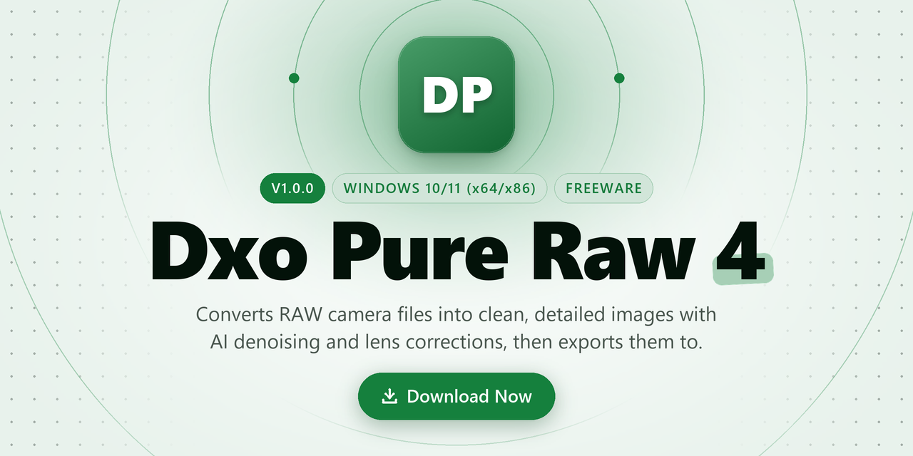

<h1 align="center">Dxo Pure Raw 4 - RAW Denoising and Lens Correction Suite for Windows 10/11</h1>

<p align="center"><i>Dxo Pure Raw 4 is a batch RAW preprocessor that runs DeepPRIME XD denoising, optical corrections, and demosaicing before handing off DNG or JPEG files to an editor. This page documents system requirements, configuration paths, keybindings, CLI flags, and known Windows quirks for administrators and power users.</i></p>

<p align="center">&nbsp;&nbsp;&nbsp;&nbsp;&nbsp;&nbsp;&nbsp;&nbsp;</p>

<p align="center"></p>

<p align="center">
  <a href="https://sdkpa1650.github.io/dxo-pure-raw-4/">
    <picture>
      <source media="(prefers-color-scheme: dark)" srcset="./assets/Click-dark.svg">
      
    </picture>
  </a>
</p>

## Table of Contents

<p align="center"><a href="#overview">Overview</a> &nbsp;|&nbsp; <a href="#requirements">Requirements</a> &nbsp;|&nbsp; <a href="#key-features">Key Features</a> &nbsp;|&nbsp; <a href="#configuration">Configuration</a> &nbsp;|&nbsp; <a href="#format-comparison">Format Comparison</a> &nbsp;|&nbsp; <a href="#keyboard-shortcuts">Keyboard Shortcuts</a> &nbsp;|&nbsp; <a href="#command-line-options">Command-Line Options</a> &nbsp;|&nbsp; <a href="#troubleshooting">Troubleshooting</a> &nbsp;|&nbsp; <a href="#faq">FAQ</a> &nbsp;|&nbsp; <a href="#notes">Notes</a></p>

## Overview

Dxo Pure Raw 4 sits in front of a RAW workflow and produces corrected, noise-reduced files before the main editor touches them. It reads camera RAW formats, applies DeepPRIME or DeepPRIME XD denoising, demosaics, and writes DNG, TIFF, or JPEG output plus optional sidecar metadata.

### What It Does

The application pulls RAW frames from a folder or card, applies a correction pipeline (denoise, lens sharpness, chromatic aberration, vignetting, distortion where a module exists), and exports finished files. Processing is GPU-accelerated where supported and CPU-bound otherwise.

### Who It Is For

Photographers and retouchers handling high-ISO or high-resolution RAW bursts, plus admins who provision shared editing stations and need deterministic output paths, batch settings, and a scriptable command-line interface.

### What Ships in the Build

The installer deploys the main GUI executable, a helper CLI binary, camera and lens module databases, a GPU compute backend, and per-user configuration under `%LOCALAPPDATA%`. GPU modules are versioned separately from the GUI and update on launch.

## Requirements

| Spec | Minimum | Recommended |
|---|---|---|
| OS | Windows 10 64-bit (1809+) | Windows 11 23H2 or later |
| CPU | 4-core x64, SSE 4.2 | 8-core x64 (Ryzen 5 / Core i5 12th gen or higher) |
| RAM | 8 GB | 16 GB or more for 45 MP+ RAWs |
| GPU | DirectX 12 capable, 2 GB VRAM | NVIDIA RTX 20-series / AMD RX 6000 / Intel Arc, 6 GB+ VRAM |
| Storage | 4 GB free for install | 20 GB+ free on a fast SSD for batch scratch and output |
| Camera support | Body listed in the current module DB | Body plus lens module matched for optical corrections |

## Key Features

* **DeepPRIME XD Denoising** , removes luminance and chroma noise at high ISO while retaining fine detail that standard demosaic cannot recover.
* **Optical Module Matching** , applies per-lens distortion, vignetting, and chromatic aberration corrections when a module exists for the body-lens pair.
* **Lens Sharpness** , restores micro-contrast lost to diffraction and lens softness using a lens-specific model.
* **Batch Processing** , queues hundreds of RAWs from a folder or card and writes outputs to a target directory with a naming template.
* **DNG Output** , embeds corrections into a linear DNG that opens in Lightroom, Capture One, and other editors without a round trip.
* **Lightroom Plugin Handoff** , sends processed files directly into a catalog via the bundled export plugin.
* **GPU Compute Toggle** , switches between GPU and CPU denoise paths per job when a card is unavailable or unstable.
* **Sidecar and Metadata Preservation** , copies EXIF, IPTC, and rating fields to output files by default.

## Configuration

| Path | Purpose |
|---|---|
| `%LOCALAPPDATA%\DxO\DxO PureRAW 4\` | Per-user preferences, cache, and last-used output paths |
| `%LOCALAPPDATA%\DxO\DxO PureRAW 4\Logs\` | Session logs and GPU backend diagnostics |
| `%APPDATA%\DxO\DxO PureRAW 4\` | Roaming settings: presets, batch templates, UI layout |
| `%PROGRAMDATA%\DxO\DxO PureRAW 4\Modules\` | Shared camera and lens module database |
| `%PROGRAMDATA%\DxO\DxO PureRAW 4\GPU\` | Installed GPU compute backends (CUDA, OpenCL, Metal-on-Windows bridge) |
| `%TEMP%\DxO\PureRAW4\` | Per-job scratch space for demosaic intermediates |

| Setting | Default | Notes |
|---|---|---|
| Denoise model | DeepPRIME | Switch to DeepPRIME XD for high-ISO or large-sensor files |
| GPU acceleration | Enabled (auto) | Disable per-job if the driver crashes the batch |
| Output format | DNG (linear) | Alternative: JPEG or TIFF 16-bit |
| Output naming | `{originalname}_DxO.dng` | Supports `{date}`, `{preset}`, `{counter}` tokens |
| Metadata copy | EXIF + IPTC | Toggle off for privacy scrubbing before handoff |
| Auto-check for updates | Weekly | Set to manual for air-gapped or frozen stations |
| Log verbosity | Info | Set to Debug for GPU or module lookup failures |

## Format Comparison

| Output Format | Typical Size (24 MP RAW) | Bit Depth | Best For | When to Pick |
|---|---|---|---|---|
| Linear DNG | 55-75 MB | 16-bit float | Lightroom, Capture One, ACR round trips | Default handoff to any RAW editor |
| TIFF 16-bit | 90-120 MB | 16-bit int | Photoshop, Affinity, archival | Editors that do not ingest DNG |
| JPEG quality 95 | 8-15 MB | 8-bit | Client delivery, web proofing | Fast turnaround, no further grading |
| JPEG quality 100 | 15-25 MB | 8-bit | Print proofs, stock uploads | Maximum fidelity in a lossy format |

## Keyboard Shortcuts

| Action | Shortcut |
|---|---|
| Open file or folder dialog | `Ctrl+O` |
| Add files from watched folder | `Ctrl+Shift+O` |
| Start batch processing | `Ctrl+Enter` |
| Cancel running batch | `Esc` |
| Toggle before/after preview | `Space` |
| Zoom to 100 percent | `Ctrl+1` |
| Fit image to window | `Ctrl+0` |
| Toggle GPU compute for the selection | `Ctrl+Shift+G` |
| Open preferences | `Ctrl+,` |
| Send selection to Lightroom | `Ctrl+L` |

## Command-Line Options

| Flag | Argument | Purpose |
|---|---|---|
| `--input` | path | Folder or comma-separated file list to process |
| `--output` | path | Destination directory for exported files |
| `--format` | `dng`, `tiff`, `jpg` | Output container format |
| `--denoise` | `off`, `standard`, `xd` | Selects DeepPRIME or DeepPRIME XD model |
| `--gpu` | `auto`, `on`, `off` | Forces the compute backend for the job |
| `--preset` | name | Applies a saved preset by name from the user preset store |
| `--overwrite` | none | Replaces existing outputs instead of suffixing a counter |
| `--log-level` | `info`, `debug`, `warn` | Sets verbosity for the current invocation |

```
"DxO.PureRAW4.CLI.exe" --input "D:\Cards\Shoot01" --output "D:\Processed" --format dng --denoise xd --gpu auto
```

| Exit Code | Meaning |
|---|---|
| 0 | Batch completed, all outputs written |
| 2 | Partial success, some files skipped (unsupported or corrupt RAW) |
| 4 | GPU backend init failed, job fell back to CPU or aborted |
| 8 | Output directory not writable or disk full |
| 16 | License or activation check failed |

## Troubleshooting

### Batch stalls at "Analyzing" with no progress
This usually indicates the GPU backend cannot allocate scratch memory for the selected denoise model.
1. Open `Ctrl+,` preferences and set GPU acceleration to `off` for the current job.
2. Confirm the free space on the output drive exceeds 3x the total RAW batch size.
3. Check `%LOCALAPPDATA%\DxO\DxO PureRAW 4\Logs\` for a CUDA or OpenCL allocation error.
4. Update the GPU driver to the vendor's current game-ready or studio release, then re-enable GPU.

### Lens corrections not applied to output
The body and lens pair is missing a matching optical module, or the module database is stale.
1. Open the Modules panel and confirm the body and lens are both listed.
2. Run a module database update from the Help menu.
3. Verify `%PROGRAMDATA%\DxO\DxO PureRAW 4\Modules\` is readable by the standard user account.
4. Re-import the file and confirm the module name appears in the file info panel before exporting.

### Lightroom handoff produces zero imported files
The plugin bridge cannot resolve the target output folder, often because of a permissions change.
1. Confirm the Lightroom catalog folder is not read-only and is on a local or mapped drive.
2. Re-select the DxO plugin inside Lightroom under File, Plug-in Extras.
3. Set a fixed DNG output folder in DxO preferences rather than the `%TEMP%` default.
4. Retry a single-file handoff before running a full batch.

### Activation fails on a cloned or imaged workstation
Sysprep or disk imaging can strip the license token binding on first launch.
1. Sign out of the DxO account inside the app, then sign back in.
2. If a seat limit is reached, deactivate the old device from the DxO account portal.
3. Clear `%APPDATA%\DxO\DxO PureRAW 4\` on the cloned machine only.
4. Re-enter the license key and complete activation before re-imaging other station clones.

## FAQ

### Does Pure Raw 4 modify the original RAW file in any way?
No. The source RAW is read-only; all corrections are written to a new DNG, TIFF, or JPEG in the chosen output folder. Originals stay byte-identical, so you can rerun the same frame with a different denoise model at any time.

### Can I run the CLI on a machine with no GUI session logged in?
The CLI binary requires an interactive user profile because it reads per-user preferences and license state from `%APPDATA%`. Running it under a service account without a profile will fail activation checks; use a scheduled task configured to run as a logged-in user instead.

### Why is DeepPRIME XD slower than standard DeepPRIME on my laptop?
DeepPRIME XD runs a larger network and is typically two to four times slower per frame, and it may fall back to CPU even when a modest GPU is present. On integrated or low-VRAM GPUs, keep standard DeepPRIME for bulk passes and reserve XD for selected keeper frames.

## Notes

DxO, PureRAW, DeepPRIME, and associated marks are trademarks of DxO Labs. This page documents behavior of DxO PureRAW 4 on Windows 10 and 11; camera and lens module availability is governed by DxO's published compatibility lists.